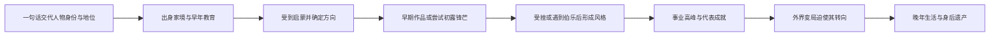

# 备考策略

① **提升英语硬实力**——单词和语法的正确输入

- 单词: 见词知意
- 语法: 能够快速阅读长难句和造句, 提升略读和精读能力

**②** **熟练运用做题技巧**——把已有实力发挥到 100%

- 题目类型和对应题目的出题陷阱
- 不同题型组合下的最优解题顺序

# 破局法则

## 实战法则

- 阅读题目确定查找词: 专有名词等
- 原文定位查找词位置: 考验略读和精读
- 将原文和题目按照如下实战法则进行核对, 最终完成题目

| 实战法则     | 具体做法                                                                                                                                 |
| :------- | :----------------------------------------------------------------------------------------------------------------------------------- |
| **回填通读** | 填空题填完后, 把答案放回题干整句读一遍 语法、词性或语义不通即错 (如 *worked in a ___* 要填地点, 填身份则不通)                                                              |
| **核对三点** | 谁 (主体)、做了什么 (动作、方向、因果)、范围 (时间、数量、条件、整段还是细节) 三点在原文同一处都对上才选, 缺一即排除                                                                  |
| **查绝对词** | 选项有绝对词或比较词 原文无等价表达即排除                                                                                                             |
| **核对原词** | 题目出现原词 先看原词在原文是否处于否定语境                                                                                                            |
| **核对观点** | 原文句子分三类: 旧观点 (*assumed, traditionally*)、事实 (*revealed, found that*)、推测 (*may, likely*) 题干把旧观点当事实 ➔ FALSE / NO; 把推测当定论 ➔ NOT GIVEN |
| **还原细节** | 题干出现抽象的概括词 (如 *reconsider, impact, nature*) 不找原词, 把它还原成具体的动作或态度, 去原文找对应细节; 内容能支持且无冲突才判 TRUE                                       |
## 正确项伪装

| 伪装机制     | 出题特征                                                                                                                                                                              |
| :------- | :-------------------------------------------------------------------------------------------------------------------------------------------------------------------------------- |
| **抽象替换** | 把原文的具体过程、细节提炼成学术大词, 字面与原文完全不像 如选项 *the nature of the research* ⟷ 原文 *data work*; 常见大词 *consequences, mechanism, implications* (单选题, 选段落标题, 段落信息匹配)                          |
| **近义换词** | 选项或答案词是原文表达的普通近义词, 字面不同但含义相同, 常见于选词填空和填空题 如 *tedious* ➔ *boring*; *countless arguments* ➔ *numerous disputes*; *stress* ➔ *anxiety* 方框词每词只能用一次, 先把确定的词划掉再选剩余 (选词填空, 填空题) |
| **句式改写** | 把隐含逻辑改成显性谓语, 把多行修饰压缩成一句, 或直接改写段落的修辞功能 如 *by doing A* ➔ *A caused B*; *Although X, Y, the aim was Z* ➔ *Z was the aim*; 原文举例 ➔ 选项 *illustrates…* (判断题, 单选题, 选段落标题)           |
| **熟词僻义** | 用熟词的学科义, 制造“生词/未提及”假象, 学术文自动切换学术义项 如 *nature* (性质)、*condition* (制约)、*address* (探讨)、*subject* (使遭受)、*plant* (工厂) (判断题, 单选题)                                                  |
| **数据换算** | 把数字换成另一种说法, 数值本身没变 如 *25%* ➔ *a quarter*; *1990–1999* ➔ *the 1990s*; *twice as many* ➔ *100% more* (判断题, 填空题)                                                               |
| **正反语态** | 肯定变双重否定, 主动变被动, 主客体互换 如 *unnecessary* ➔ *no need for*; *A preceded B* ➔ *B followed A* (判断题, 单选题)                                                                           |
| **时态替代** | 题干不写时间词, 时间信息只留在动词时态里; 原文的过去式、完成时说的是已经发生的事实 如 *the original library … collected* ➔ *the library … collected* (都是过去式, 同一时间); 原文 *joined the collections* (已经收藏) ⟷ 题干 *have never collected* (矛盾) 先比对题干与原文的动词时态: 一致就是同一时间, 题干改成现在时才是在问现在 (判断题, 单选题) |

## 常见陷阱

| 陷阱类型      | 出题特征                                                                                                          |
| :-------- | :------------------------------------------------------------------------------------------------------------ |
| **正确项伪装** | 正确项被改写得不像原文, 容易误判成 FALSE / NG 出现抽象大词、换算后的数字、主被动互换, 要留意是否只是同义改写, 详见 [[#正确项伪装]] (判断题, 单选题)                |
| **细节错配**  | 数字、时间、地点、条件等细节被调换或张冠李戴 出现数字、年份、地点、条件 (如 *1999*, *low temperature*), 要留意是否对得上 (判断题, 填空题, 单选题)            |
| **事实矛盾**  | 与原文直接反义 出现 *increase / decrease*、*before / after*、*open / closed* 等可反义的词, 要留意是否与原文方向一致 (判断题, 单选题)       |
| **无中生有**  | 选项内容原文完全没提, 凭常识脑补 出现原因、结果、修饰等额外信息 (如 *due to flooding*), 要留意原文是否真有 (判断题, 单选题, 多选题)                      |
| **主体混淆**  | 把 A 的动作移花接木给 B 出现人名、机构名作动作主语 (如 *Jones proposed*), 要留意动作是谁做的 (填空题, 单选题, 多选题, 人名匹配题, 段落信息匹配)             |
| **以偏概全**  | 拿段内某个细节冒充全段主旨, 或只覆盖一部分内容而漏掉主体 出现具体的数据、人名、例子, 要留意它能否代表整段或整篇 (选段落标题)                                      |
| **范围偷换**  | 把局部、温和、或然的描述擅自加上程度词, 升级为绝对 出现 *only, all, must, solely, primarily*, 要留意原文是否有同等程度的表达 (判断题, 单选题, 多选题)     |
| **原词被否**  | 干扰项照搬原文扎眼的词, 但该词处在原文虚拟、设问、让步等否定语境 出现扎眼的原词 (如 *X*), 要留意它在原文是否处于否定语境 (填空题, 单选题, 段落信息匹配)                   |
| **假说当真**  | 把被后文推翻的旧假设、误解、推测写成客观事实 出现 *proves, shows, is known to* 等肯定断言, 要留意原文是否只是 *assumed, claimed* (判断题, 人名匹配题) |
| **虚构比较**  | 原文只分述 A、B, 选项凭空捏造比较或最高级 出现 *more...than, superior to, greatest, replace*, 要留意原文是否真有比较 (判断题)             |
| **强加因果**  | 颠倒因果方向, 或把先后、并列的两件事绑成因果 出现 *because, lead to, as a result of*, 要留意原文是否真有因果 (判断题, 单选题)                   |

# 题型矩阵

| 题型         | 要点                                                                                                     |
| :--------- | :----------------------------------------------------------------------------------------------------- |
| **判断题**    | **常识归零**：严禁脑补常识, 原文未提就判 NOT GIVEN **FALSE 与 NG**：FALSE 是原文明说且正面冲突, NOT GIVEN 是原文没说或擅自添加关系、因果、比较     |
| **单选题** | **用题干定位词**：先锁定段落, 再对选项逐个核对 **错误选项**：本质上是 FALSE 或 NOT GIVEN, 对照这两个判断 |
| **填空题**    | **回填通读**：填完回读一遍, 语法不通即错 **并列双锚点**：空格带并列项时, 两项都在原文核对到才下笔                                             |
| **多选题**    | **跨段分散扫描**：答案常分散在几段, 找到一个不要停 **主客观对号入座**：分清作者结论与背景引言, 别选反面靶子                                        |
| **人名匹配题**  | **人名指代**：首次是全名加职称, 之后用姓氏或 he / she, 别漏读 **观点动词**：比对人名对应的观点动词, 分清假说与实证 **NB 标志**：有 NB 说明人名可能用不止一次 |
| **选段落标题**  | **拒绝局部原词**：别因为扫到某个选项词就选该标题 **抓首尾主干剥离例子**：只看段首立论句和段尾总结句, 忽略例子                                        |
| **段落信息匹配** | **核对动作主体**：核对动作是谁做的, 年代是否对得上 **不见原词向下归纳**：抽象大词不要找原词, 去找具体细节 **抽象名词预判段落功能**：由题干抽象名词推断段落在文中的功能     |

段落信息匹配题（Matching Information）的题干极少使用具象词, 而是大量使用高度提炼的**抽象名词**。这些抽象名词不仅是同义改写的外壳, 而且**直接预示了该信息在整篇文章中所处的功能段落与核心信号句式**：

| 题干核心抽象词 | 原文特征 |
| :-- | :-- |
| **`realisation that...`** (意识到) | **认知重构段** (后半部) `realise` / `become aware of` / `acknowledge` |
| **`neurological / scientific evidence`** (科学实证) | **实验机制段** (前中部) `brain imaging` / `MRI` / `laboratory` |
| **`false assumption / misconception`** (误区) | **破除迷思段** (第 2 段) `Contrary to popular belief` / `myth` / `mistakenly think` |
| **`data / evidence / demonstrated that`** (数据 / 实证) | **实证研究段** (前中部) `data show` / `studies reveal` / `found that` |
| **`suggestion / recommendation / the way forward`** (建议 / 展望) | **解决措施段** (末 1~2 段) `should / need to` / `strategy` / `in the long run` |
| **`explanation of / reason for`** (原因) | **因果分析段** (前中部) `is caused by` / `due to` / `account for` |
| **`description of / account of`** (描述) | **事实叙事段** (历史 / 实验过程) `first..., then...` / `consists of` / `features` |

# 考场实战

## 时间分配

| 篇章         | 时间                | 文章类型                                                         |
| :--------- | :---------------- | :----------------------------------------------------------- |
| **Part 1** | **建议 15 min**  | 事物历程 / 人物生平 / 分项说明; 词汇门槛低; 以**顺序细节题**为主（填空题、T/F/NG）。         |
| **Part 2** | **建议 20 min**  | 问题方案 / 研究报道; 常出现**段落信息配对**或**人名观点配对**。                       |
| **Part 3** | **建议 25 min**  | 作者立论 / 多方观点 / 作品评价 / 推翻旧说; 长难句多、生词密集; 常考**单选题、选词填空、Y/N/NG**。 |

## 做题顺序

1. **前置认知与排布铁律**
   - **题型属性划分**：
     - **纯顺序题**：填空题、判断题、单选题、句子配对题、局部多选题;
     - **全局乱序题**：段落信息匹配、选段落标题、人名匹配题、全局多选题;
   - **多选题属性自判准则**：
     - **局部多选题（约 70%）**：多排在全篇开头/中间, 题干带明确段落号/专名 ➔ 当作顺序细节题单段爆破, 随主轴推进;
     - **全局多选题（约 30%）**：绝大多数排在全篇最后一组, 题干宏观抽象无定位词 ➔ 当作全局乱序题, 借前面细节题破路, 读到文末顺手割草秒杀;
   - **两大互斥铁律**：
     - 段落匹配互斥：段落信息匹配与选段落标题绝不可能同台（出题机制冲突, 绝不共存）;
     - 选择题型互斥：单选题与多选题极罕见同台（全篇通常只出现一种选择题形式）;
   - **整体解题路线**
     - **确定题目查找词**: 严禁使用高频主题词及抽象泛词, 锁定专有名词 & 时间等;
     - **查找原文同义改写**
     - **反回原文确认逻辑关系**: 确定同义改写处后, 回到题目确认逻辑关系, 最终完成题目;
   
2. **四大实战策略组合与解题流**

   - **策略组合一：纯顺序多轨同推（顺序细节题 + 顺序细节题）**
     - **适用场景**：多见于 Part 1（事实/生物/历史说明文）, 或结构线性的科普篇;
     - **预读题目**：圈出各题型前 2 题定位词进行区间试探（查看第二题型首题在文中的位置）, 判明属于**前后分割**还是**穿插交织**;
     - **核心经验**：
       - **前后分割型**：前半篇单推题型 A（Q1 ➔ Q2 ➔ ...）, 读到中后段撞见题型 B 首题时自然无缝切换题型 B;
       - **穿插交织型**：开局双挂（Q1 + Q8 靶心词）, 顺文谁先出现解谁, 解完谁顺移谁（解完 Q1 挂 Q2, 解完 Q8 挂 Q9）;
       - **通用安全绳（越界秒判 NG）**：未见前题却先撞见后题出题点 ➔ 前题大概率为 NOT GIVEN, 果断跳过绝不折返苦寻。

   - **策略组合二：主旨细节逐段同清（选段落标题 + 顺序细节题 + 顺序细节题）**
     - **适用场景**：多见于 Part 2 或 Part 3;
     - **预读题目**：必须先预读所有 Heading 标题选项并圈画核心关键词（严禁不读标题就读文章, 严禁留到最后做）;
     - **核心经验**：
       - **段落闭环**：顺文精读每段首尾立论总结句与段中强转折 ➔ 读完一段立即选出该段选段落标题;
       - **顺带清题**：在读该段过程中, 顺手清空该段命中的填空题/判断题等细节题。

   - **策略组合三：顺序破路与语篇割草（段落信息匹配 / 人名匹配 + 顺序细节题 + 顺序细节题）**
     - **适用场景**：多见于 Part 2（极高频出现信息匹配）或 Part 3;
     - **预读题目**：预读乱序题的核心抽象大词（如 *evidence, recommendation, misconception*）或人名列表（注意 NB 标志提示复用）, 大脑建立“被动雷达”, 绝不回文盲目硬搜;
     - **核心经验**：
       - **顺序破路**：顺文精读, 优先推进后文的填空题/判断题等顺序细节题;
       - **语篇割草**：利用精读段落沉淀的语篇深度记忆, 顺手“割草”收割段落信息匹配或人名匹配题; 读完文章仅需定点扫尾极少数未读段落。

   - **策略组合四：双难题复合多维协同（选段落标题 / 段落信息匹配 + 人名匹配 / 多选题 + 顺序细节题）**
     - **适用场景**：多见于高难 Part 2（信息匹配 + 人名匹配）或 Part 3（选段落标题 + 多选题/人名）;
     - **预读题目**：
       1. **锁定顺序主轴**：先翻到后文圈出顺序细节题（填空/判断）首题定位词, 确立全篇行军路线;
       2. **分层激活双雷达**：
          - 若含选段落标题：花 20 秒通读所有标题圈核心词（建立段落主旨框架）;
          - 扫视人名列表或信息匹配/多选题题干核心抽象词, 大脑后台建立被动雷达（绝不回文盲目硬找）;
     - **核心经验**：
       - **主轴破路**：严格顺着顺序细节题的脉络精读推进, 主轴推到哪里, 视线覆盖到哪里;
       - **文中即撞即解（人名 / 多选）**：顺文撞见大写人名或多选定位词时, 立刻停下比对选项就地解决;
       - **段尾顺手收割（标题 / 信息匹配）**：
         - 若含选段落标题：每读完一段立即回看标题列表选出, 并顺手划掉排除;
         - 若含段落信息匹配：利用刚精读完该段的深度记忆扫一眼信息匹配题干, 命中即选, 未命中果断继续;
       - **文末定点扫尾**：顺序题全部清空后, 对全文已掌握 80%, 遗留的个别乱序难题直接定点回捞秒杀。

## 应急抢分

进入第三篇仅剩 15 分钟或更短时, 放弃全篇精读, 按下面顺序做题:

1. **先做填空题**: 不读全文, 只看空格前后一句话, 回原文找原词或同义词填入;
2. **再做判断题**: 扫绝对词和转折词快速判断, 定位不到的全部蒙同一个选项;
3. **最后做段落信息匹配、多选题、单选题**: 能靠题干抽象词预判段落的就选, 其余直接蒙, 不花时间比对长难句。

# 行文结构分类

## 02. 事物历程

## 03. 人物生平

## 04. 分项说明

## 05. 问题方案

## 06. 研究报道

## 07. 作者立论

## 08. 多方观点

## 09. 作品评价

## 10. 推翻旧说

